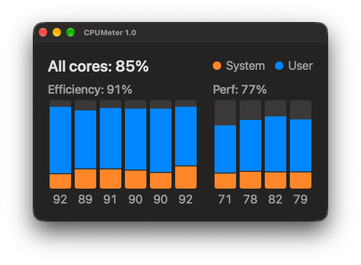

# CPUMeter

A lightweight macOS app that shows **the current usage of every CPU core** as live
bars in a small floating window, in the spirit of Activity Monitor's floating CPU
window.

It measures usage **passively**: it reads the operating system's per-core counters
and computes the change each interval. It keeps no history, writes no logs and needs
no elevated privileges.



*At the Large size on an M4 (6 Efficiency and 4 Performance cores), in the dark
appearance, under a synthetic load that keeps every core busy but not full.*

> **Status: v1.0.** All 34 requirements, with their 20 sub-requirements, are met,
> checked against the running app. See the
> [build plan](docs/cpu-meter-build-plan.md) for the record of each increment, the
> [requirements](docs/cpu-meter-requirements.md) for the requirements themselves,
> and the [UI design](docs/cpu-meter-ui-design.md) for the layout.

## Features

- **One bar per core**, grouped by core type, such as Efficiency and Performance,
  from lowest to highest performance. The group names come from macOS rather than
  being built in, so a Mac with other core types, such as the M5 Pro's Super cores,
  shows them as macOS names them.
- **System and user time stacked in each bar**, with system time at the base, as in
  Activity Monitor. They're orange and blue by default, and each can be changed with
  the macOS color chooser (View → Colors).
- **Figures at three levels:** "All cores" for the whole CPU, each group's average in
  its label, and each core's percentage under its bar.
- **Any size from Small up**, dragged from any edge or corner. The whole meter scales
  together and keeps its shape. View → Size has Small, Medium and Large presets
  (⇧⌘S, ⇧⌘M, ⇧⌘L), and the green window button grows the meter to the largest size
  the screen allows and back.
- **A width that fits the Mac's core count,** up to the current maximum of 36 cores.
- **Adjustable refresh rate**, 1–5 seconds (⌘1–⌘5).
- **Keep on Top**, on by default.
- **Pauses** sampling and drawing while the window can't be seen: minimized, fully
  covered, or with the display asleep.
- **Remembers** its size, position, refresh rate, colors and Keep on Top, and opens
  at the top-left of the screen the first time.
- **Follows the system light or dark appearance.**
- **A tiny footprint**, measured below.

Closing the window quits the app; relaunch it to bring it back. ⌘W closes only the
About box or the color chooser, never the meter, so a ⌘W meant for another app can't
quit it.

## Reading the meter

- **Efficiency cores often look busier than Performance cores** while the Mac is
  quiet. macOS runs background work on the Efficiency cores and keeps the Performance
  cores for what you're doing, so this is expected.
- **A percentage is the share of time a core was busy, not how much work it did.**
  Efficiency and Performance cores run at different speeds, and each core's speed
  changes with the load, so 50% on an Efficiency core is less work than 50% on a
  Performance core. CPUMeter doesn't show clock speeds.
- **It agrees with Activity Monitor.** Under steady loads on both test Mac minis, with
  both apps refreshing every second, the meter followed Activity Monitor to within
  half a point. The two never sample at the same moment, so at any one instant they
  can differ.

## Measured cost

Release builds, each measured over an hour after a 5-minute warm-up, at a 1-second
refresh (November 2026):

| Mac | Size | CPU | Memory footprint |
|---|---|---|---|
| M4 Mac mini, macOS 27.2 | Medium | 0.37% of one core | about 26 MB |
| 2020 M1 Mac mini, macOS 27.2 | Medium | 0.57% of one core | about 25 MB |
| 15-inch M3 MacBook Air, on battery, macOS 27.2.1 | Large | 0.43% of one core | about 23 MB |

CPU and memory stay level across the hour. On the M4, CPU is about the same at every
size, from Small up to the largest the screen allows, which uses about 15 MB more
memory. On the Air, Activity Monitor's Energy tab gave CPUMeter an Energy Impact of
0.3, and the whole Mac's battery went from 91% to 89% over the 65 minutes.

## What was and wasn't tested

On real hardware, on macOS 27.2 and 27.2.1:

- **M4 Mac mini** (10 cores: 6 Efficiency, 4 Performance): every check.
- **2020 M1 Mac mini** (8 cores: 4 Efficiency, 4 Performance): the checks that needed
  a second Mac, including the core labels under load, accuracy, footprint, colors and
  free sizing.
- **15-inch M3 MacBook Air** (8 cores: 4 Efficiency, 4 Performance): energy use on
  battery, and the window on a Retina display with a notch.

**Simulated only:** every other core count, meaning 6 cores and everything from 11 to
36, and core-type names other than Efficiency and Performance. On those, the layout
was checked by running the meter with simulated cores at each size, but it hasn't run
on such a Mac.

## Requirements

- **macOS 27** or later
- **Apple Silicon** Mac only: the project builds `arm64` only
- **Xcode 27** or later to build

## Download

A zipped build is on the [Releases](https://github.com/chrisARC3/macos-cpumeter/releases)
page. It isn't notarized by Apple, so macOS won't open it the first time:

1. Unzip it, and move **`CPUMeter.app`** into **`/Applications`**.
2. Open it. When macOS says it can't check the app, click **Done**.
3. In **System Settings → Privacy & Security**, find the message about CPUMeter and
   click **Open Anyway**, then confirm.

After that it opens normally.

## Build & run

1. Clone the repo and open **`CPUMeter/CPUMeter.xcodeproj`** in Xcode.
2. In **Signing & Capabilities**, select your own **Team**. The project ships with
   the author's team ID, so Xcode will prompt you to choose yours; automatic signing
   handles the rest. (Hardened runtime and the App Sandbox are enabled.)
3. Select the **CPUMeter** scheme and press **⌘R** to build and run.

Or from the command line (add your team ID, since the checked-in one is the
author's):

```sh
xcodebuild -project CPUMeter/CPUMeter.xcodeproj -scheme CPUMeter \
  -configuration Release -destination 'platform=macOS' \
  -derivedDataPath build DEVELOPMENT_TEAM=YOUR_TEAM_ID build
```

The built app lands at `build/Build/Products/Release/CPUMeter.app`.

## Install for daily use

1. Build the **Release** configuration (the `xcodebuild` line above, or
   **Product → Archive** in Xcode and export a copy of the app), or download it.
2. Move **`CPUMeter.app`** into **`/Applications`**.
3. To start it automatically at login, add it in
   **System Settings → General → Login Items**. CPUMeter intentionally doesn't
   manage login items itself, to keep it minimal.

## How it works

Every interval (1–5 s), CPUMeter calls `host_processor_info` for each core's
cumulative user, system, idle and nice ticks, about 100 a second, and works out each
core's share of the ticks since the last read. The counters are 32-bit, so the change
uses wrapping arithmetic, and nice time counts as user time. The "All cores" figure
and the group averages come from the raw ticks, not from rounded per-core figures.

Core types come from each core's `cluster-type` in the IORegistry, and the group names
from `hw.perflevelN.name`. They're matched by logical core ID: on the M4 and the M1
the two numberings run in opposite directions, so matching them by position would
mislabel every bar. If they can't be matched reliably, the meter shows one row of
bars with no label rather than risk a wrong one.

The meter is drawn with Core Animation layers, and an update changes only the layers
whose values changed. SwiftUI's `Canvas` was tried first and dropped: at Medium and
larger it left a system timer behind on every redraw, so CPU use climbed for as long
as the app ran. Nothing is saved except your settings and the window's position and
size.

Reading the counters needs **no elevated privileges** and no helper: it works from
inside the App Sandbox with no entitlement exceptions.

## Not included (by design)

No WidgetKit widget, since a widget refreshes about every 5 minutes at best, far
slower than 1–5 seconds. No history or graph; no GPU, memory, temperature, clock-speed
or per-process figures; no logging; no menu bar item; no other shapes, transparency or
second window; and no built-in launch at login. VoiceOver labels for the meter are
left for later. See [`docs/`](docs/) for the full requirements and the incremental
build plan.

CPUMeter is a sibling to **NetSpeed** and **DriveSpeed**, which do the same job for
network and disk throughput, and shares their structure.

## License

[MIT](LICENSE) © 2026 ARC3 Solutions

## /\* Begin Note From The Human
This is the fourth MacOS App I have authored from scratch using Claude Code for the entirety (except this message, of course!). This one was exclusively developed with Opus 5.5, thinking = Extra. Again, I'm super pleased with the result. It does exactly what I've always wanted Apple's Activity Monitor to do: show CPU usage in an always-on-top window, but with way more display options, more useful information and MUCH lower resource consumption - since the tool does not track per-process CPU usage, it consumes about an order of magnitude less CPU than Activity Monitor.

I hope you enjoy using it.

Cheers,

Chris
## End Note From The Human \*/
